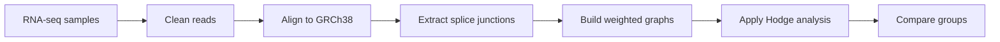

**[Start here: view the complete Splice Girl project map](mermaid.md)**

# Splice Girl

**Using graphs and Hodge theory to study RNA splicing in endometriosis**

Splice Girl is a research software project that turns RNA splice-junction data
into graphs. Those graphs let us ask whether RNA connections are organized
differently in endometriosis and control endometrial tissue.

> **Current status (November 24, 2026):** the Rust program, graph
> construction, Hodge decomposition, case/control comparison, exact
> permutation statistics and mathematical checks are finished and tested. A
> [real CDH11 technical pilot](data/pilots/SRR36710387_prefix1m_nov17/README.md)
> passes independent verification on real control reads. The eight-sample
> analysis is fully specified in advance
> ([settings](analysis/cohort_primary/README.md),
> [interpretation plan](docs/interpretation_plan.md)); alignment of the last
> samples on the university cluster is in progress, so no case/control
> result is reported yet.

## Team: Splice Girls

**Project idea:** use genetic-risk and environmental-response evidence to
choose endometriosis-related genes, turn each gene's RNA splice junctions
into a graph, and use Hodge decomposition to measure whether endometriosis
and control tissue organize their splicing differently.

| Member | Role |
|---|---|
| Vania Zeledon | Computational development & mathematical theory |
| Summer Malik | Lead programmer & mathematical modeling |
| Sydney Holmes | Biological research |
| Wynn Oo | RNA-seq data & splice-junction research |

**Language:** Rust for the Splice Girl program (graph construction, Hodge
decomposition, statistics, reports); Python for read preprocessing,
gene-set building and result interpretation.

## Algorithm (pseudocode)

```text
# 1. Choose candidate genes (Python, gene_sets/)
risk_genes  <- genes reported for endometriosis in GWAS Catalog + Koller et al. 2026
env_genes   <- human genes with measured responses to dioxin-like chemicals in CTD
               (>= 2 publications, at least one not a large screen)
candidates  <- risk_genes UNION env_genes            # 661 genes
label each candidate risk_only, environment_only or overlap

# 2. Count splice junctions per sample (Python, preprocessing/)
for each RNA-seq sample:
    clean reads (Cleaver/fastp); align to GRCh38 with HISAT2 (RF strandedness)
    check read-1 orientation; exclude the sample if < 95% agree
    for each uniquely mapped read spanning an intron (>= 8 bases each side):
        map the intron to (gene, from_exon_node, to_exon_node) using GENCODE
        count[sample, gene, edge] += 1           # ambiguous junctions excluded

# 3. One shared graph per gene, chosen without case/control labels (Rust)
for each candidate gene:
    edges <- junctions with >= 5 reads in >= 4 of the 8 samples
    keep gene if cycle_rank = |edges| - |nodes| + components >= 1
           and every sample has >= 50 reads on these edges

# 4. Hodge decomposition per sample and gene (Rust)
F       <- count[edge] / total count            # normalized edge signal
B1      <- incidence matrix (-1 at source node, +1 at target node)
phi     <- argmin || F - B1^T phi ||^2           # least squares
F_grad  <- B1^T phi                              # gradient (directional) part
F_cycle <- F - F_grad                            # cycle-space part, B1 F_cycle = 0
C       <- ||F_cycle||^2 / ||F||^2               # cycle fraction
verify reconstruction, B1 F_cycle ~ 0 and F_grad . F_cycle ~ 0

# 5. Compare endometriosis with controls (Rust)
for each gene: effect <- mean C(cases) - mean C(controls)
statistic <- mean over genes of |effect|
for each of the 70 ways to label 4 of 8 samples as cases:
    recompute the statistic
p <- fraction of relabelings with statistic >= observed
rank genes by |effect|; report the junctions that carry each change
compare with a simpler baseline (junction-usage entropy) under the same test
```

## The project shortened:

1. RNA sequencing shows which parts of a gene were connected in each sample.
2. Splice Girl represents those connections as a graph.
3. Hodge theory separates the graph signal into node-explainable flow and
   alternative-path or cycle-space flow.
4. We compare the resulting measurements between four control and four
   endometriosis samples.

The goal is to move from millions of sequencing reads to a small set of
transparent, mathematically checked measurements that can support biological
interpretation.

## Explore the project:

| If you are interested in... | Read this section |
|---|---|
| The team and roles | [Team: Splice Girls](#team-splice-girls) |
| The algorithm in pseudocode | [Algorithm (pseudocode)](#algorithm-pseudocode) |
| How every project layer connects | [Complete project map](mermaid.md) |
| The biological question | [Why study RNA splicing?](#why-study-rna-splicing) |
| The graph idea | [From RNA connections to a graph](#from-rna-connections-to-a-graph) |
| The mathematics | [Why Hodge theory?](#why-hodge-theory) |
| The software | [What Splice Girl does](#what-splice-girl-does) |
| Our progress | [What we have built](#what-we-have-built) |
| The public data | [The eight-sample study](#the-eight-sample-study) |
| A live demonstration | [Try Splice Girl](#try-splice-girl) |
| Every demo step, expected answer and troubleshooting | [Documented beginner walkthrough](beginner_test/README.md) |
| Running the complete software workflow | [Step-by-step software guide](docs/running_the_tool.md) |
| Processing local FASTQ samples | [Cleaver/HISAT2 guide](preprocessing/HISAT2_GUIDE.md) |
| Using less space during preprocessing | [Streaming BAM and disk checks](preprocessing/HISAT2_GUIDE.md#save-disk-space-with-streaming-bam) |
| Checking one real sample end to end | [Bounded real-data pilot](docs/real_pilot.md) |
| Why some real junction counts were excluded | [Assignment and strand audit](data/pilots/SRR36710387_prefix1m_nov17/assignment_audit/README.md) |
| What to say during the demonstration | [Speaking plan and commands](docs/presentation_notes.md) |
| Completed results and what remains | [Technical results draft](docs/results_draft.md) |
| An unfamiliar word | [Beginner dictionary](#beginner-dictionary) |
| Scientific cautions | [How to interpret the results](#how-to-interpret-the-results) |

## The research question:

**Do endometriosis samples organize their RNA splice connections differently
from control samples?**

Traditional RNA-seq summaries can tell us how much of a gene was detected or
how many reads support one junction. Our project asks an additional question:
how do all of a gene's observed junctions fit together as a connected
structure?

The first analysis uses tissue-matched public RNA-seq samples from
proliferative endometrium. Every sample will pass through the same cleaning,
alignment, junction-extraction, graph, and mathematical-analysis steps.

## Why study RNA splicing?

A gene is not always used as one uninterrupted block. Cells first copy a gene
into an early RNA molecule containing sections called **exons** and **introns**.
During splicing, introns are usually removed and selected exons are joined.

Different joining choices can produce different finished RNA molecules from
the same gene. This is called **alternative splicing**. Changes in these
choices may affect which RNA and protein products a cell can make.

RNA sequencing gives us short reads that support particular exon-to-exon
connections. Those connections are called **splice junctions**. Splice Girl
uses the junctions as evidence; it does not guess connections that were not
observed.

## From RNA connections to a graph..

For one gene in one sample:

- an exon or splice site becomes a **node**;
- an observed splice junction becomes a directed **edge**;
- the number of reads supporting the junction becomes its **weight**.

A simple exon path might look like this:

```text
E1 ─────→ E2 ─────→ E3
```

An exon-skipping event adds another possible route:

```text
E1 ─────→ E2 ─────→ E3
 └────────────────→ E3
```

The second graph contains more than a list of counts. It contains two routes
from `E1` to `E3`, which gives it a different topology. Splice Girl is designed
to measure that structure consistently across samples.

## Why Hodge theory?

Hodge theory provides a principled way to separate signal on a graph. Imagine
each weighted junction as an arrow carrying flow.

Splice Girl separates that flow into:

- a **gradient component**, which can be explained by values assigned to the
  nodes; and
- a **cycle-space component**, which remains around alternative paths or loops
  after the best node-based explanation is removed.

The software summarizes the second part with a **cycle fraction**: the share of
the normalized graph signal found in the cycle-space component.

This is useful because two samples can have similar total read support while
distributing that support across different junction patterns. Hodge theory
gives us a reproducible measurement of that difference.

The full equations and validation identities are available in the
[math specification](docs/math_spec.md). Understanding those equations is not
required to understand the biological goal or run the demonstration.

## Why Rust?

Splice Girl's command-line tool is written in Rust. Rust was chosen because it
is fast, portable, and strict about many programming mistakes before the code
runs. That makes it a strong fit for a reusable analysis tool that may later
run on laptops, lab workstations, or computing clusters.

Rust does not clean or align the raw sequencing reads. Established
bioinformatics programs prepare the junction evidence first. Rust then handles
Splice Girl's input validation, graph construction, mathematical decomposition,
checks, and comparison output.

## What Splice Girl does:



In plain language:

1. Public paired-end sequencing reads are retrieved from NCBI.
2. The reads are quality-checked and cleaned.
3. HISAT2 places the reads on the exact GENCODE v50 GRCh38.p14 primary
   assembly, using its matching comprehensive annotation, as recorded in
   [`docs/data_methods.md`](docs/data_methods.md).
4. Junction-spanning reads are mapped to unique annotated exon pairs, with
   edges following biological transcript direction on both strands.
5. A project helper converts those counts into Splice Girl's input format.
6. Splice Girl builds one graph for each sample and gene.
7. The program calculates gradient energy, cycle energy, and cycle fraction.
8. Numerical checks must pass before a result is reported.
9. Eligible control and endometriosis samples can then be compared.

## What we have built:

| Completed work | What it means |
|---|---|
| Rust command-line prototype | Splice Girl can run from a terminal or interactive menu. |
| Input validation | Incorrect headers, invalid counts, self-loops, and duplicate edges are rejected clearly. |
| Deterministic graph construction | The same data produces the same node and edge order every time. |
| Hodge decomposition | Junction signal is separated into gradient and cycle-space components. |
| Mathematical acceptance checks | Reconstruction, cycle-space membership, and orthogonality are checked automatically. |
| Synthetic validation examples | Linear, branching, exon-skipping, cyclic, noisy, and edge-case graphs are tested. |
| Sample manifest support | Samples remain separate and are assigned to case or control groups. |
| Input audit command | `validate` checks samples, genes, support, manifest matching, graph construction, and mathematical checks before a full run. |
| Gene comparison command | One gene's cycle fractions can be reported across eligible samples. |
| All-gene comparison command | Every observed gene can be summarized with case/control sample counts, means, medians, ranges, exclusions, and a descriptive case-minus-control effect. |
| Offline comparison report | A plain report shows each sample's cycle fraction, excluded samples, exact values, and links to its three-panel Hodge graph. |
| Configurable statistics workflow | `stats` connects exact permutation tests and BH correction to an explicit gene family, direction, sample minimum, and independent-sample declaration, with tables and an offline report. |
| Reproducible result bundles | Metrics, junction components, comparisons, checksums, and run settings can be saved as TSV and JSON files. |
| Cleaver/HISAT2 preprocessing | Reference preparation, read cleaning, alignment, annotated-junction counting, and sequential multi-sample runs are implemented and tested on synthetic reads. |
| Baselines and optional ordering | The same eligible samples are compared using simpler graph/count measurements; tested genes can be ordered with deterministic ties. |
| Support sensitivity | An explicit threshold grid reruns the Rust analysis and keeps disappearing genes visible. |
| Public dataset selection | Four control and four endometriosis RNA-seq samples have been identified. |

The Rust project currently has **100 automated tests**. Real-data
preprocessing is the next active stage, and the large raw-read files remain
outside Git.

## The eight-sample study:

The current dataset is [GEO GSE315857](https://www.ncbi.nlm.nih.gov/geo/query/acc.cgi?acc=GSE315857).
It contains paired-end RNA-seq data from proliferative endometrium.

| Group | Number of samples | SRA runs |
|---|---:|---|
| Control | 4 | `SRR36710390` to `SRR36710387` |
| Endometriosis | 4 | `SRR36710386` to `SRR36710383` |

The complete working manifest is
[`data/metadata/samples.tsv`](data/metadata/samples.tsv). It records the exact
GEO and SRA accessions, internal subject labels, case/control status, matched
tissue, file locations, QC status, and what processing is still pending. The
earlier accession-only table remains in
[`endometriosis-splicing/samples.tsv`](endometriosis-splicing/samples.tsv) for
provenance.

The processing plan is:

```text
8 public SRA runs
        ↓
quality control and cleaning
        ↓
alignment to the same human reference
        ↓
8 splice-junction files
        ↓
one graph per sample and gene
        ↓
Hodge measurements
        ↓
control-versus-endometriosis comparison
```

## How to interpret the results:

Splice Girl reports graph measurements, not a diagnosis.

- A larger cycle fraction means more of the normalized junction signal lies
  in the cycle-space component.
- A group difference would mean the measured graph feature differs between the
  sampled control and endometriosis groups.
- A cycle-space signal does **not** automatically prove circular RNA.
- A group difference does **not** prove that endometriosis caused the change.
- The result must still be reviewed for sample quality, tissue comparability,
  batch effects, replicate consistency, effect size, and statistical support.

Negative results are also meaningful. If the groups do not differ, or if the
Hodge measurements do not outperform simpler junction summaries, that should
be reported honestly.

## Try Splice Girl:

The demonstration uses tiny synthetic files included in the repository. It
does not download patient data.

Open a terminal in the project folder before running these commands. Check:

```sh
pwd
ls Cargo.toml README.md
```

`pwd` prints your current folder. The second command should list both files;
if it cannot find them, move into the downloaded project folder first.
The [beginner walkthrough](beginner_test/README.md) explains each command,
shows expected answers, and records an actual fresh-copy run.

### 1. Check Rust

```sh
rustc --version
cargo --version
```

If those commands are missing, install Rust from
[rustup.rs](https://rustup.rs/).

Splice Girl requires **Rust 1.85 or newer**. Install the published command:

```sh
cargo install splice-girl --locked
```

To install the current code from this repository instead, run:

```sh
cargo install --path . --locked
splice-girl --version
splice-girl --help
```

After installation, the junction-analysis workflow works from your own folder:

```sh
splice-girl example --output splice-girl-example
```

Open `splice-girl-example/README.md` for complete copyable commands. The
installed `prepare-shared` and `sensitivity` commands prepare common graphs,
record exclusions and run the threshold grid directly in Rust. They need no
Python or repository checkout. See the [installed walkthrough](examples/shared_graph/INSTALLED.md).
Raw FASTQ preprocessing still uses the separate Cleaver/HISAT2 tools.

The example also contains a saved configuration:

```sh
splice-girl check --config splice-girl-example/analysis.json
splice-girl run --config splice-girl-example/analysis.json
```

Open `splice-girl-example/configured-results/report.html`. The
[configuration guide](docs/configuration.md) explains the read-only checks,
pipeline provenance and saved settings. The [first-time reviewer exercise](docs/user_acceptance.md)
remains available for an independent reader to complete.

Splice Girl 0.2.0 and later source releases are licensed under
[CC BY 4.0](https://creativecommons.org/licenses/by/4.0/), which allows
commercial and noncommercial reuse with attribution and notice of changes.
The published 0.1.0 crate remains MIT-licensed. If you use the software in a
paper, please cite it and record the version or commit; `splice-girl cite`
prints the metadata in [CITATION.cff](CITATION.cff).

Cargo normally places installed commands in `$HOME/.cargo/bin`. If the install
succeeds but `splice-girl` is not found, add that directory to your shell's
`PATH`, restart the terminal, and try `splice-girl --version` again. You can
also use every example below with `cargo run --` without installing globally.

### 2. Open the interactive menu

From the repository folder, run:

```sh
cargo run -- --start
```

Type `1`, press Return, then enter this at **Junction TSV path**:

```text
tests/fixtures/cycle.tsv
```

When asked for **Output folder**, press Return to leave it blank; this example
prints its results in the terminal. Expect `cycle_fraction: 1.0000000000` and
`checks: PASS`. Press Return to return to the menu, then type `q` to quit.

In the commands below, `cargo run --` builds/runs Splice Girl from its source.
Arguments after `--` are passed to Splice Girl. If you installed the command,
you can replace `cargo run --` with `splice-girl` while staying in this folder.

### 3. Run a direct example

```sh
cargo run -- tests/fixtures/exon_skip.tsv
```

### 4. Audit an input before analysis

Run a compact validation report through the real parser, graph builder, Hodge
solver, and mathematical checks:

```sh
cargo run -- validate examples/demo/junctions.tsv
```

Add a manifest to check whether sample IDs match in both directions:

```sh
cargo run -- validate examples/demo/junctions.tsv examples/demo/manifest.tsv
```

The second command intentionally reports the demo's `control_03` and
`orphan_01` mismatch. This proves missing metadata and missing junction data
are visible instead of silently discarded. It exits with status `1`, an
expected failure for this deliberately mismatched example. The first command
should pass with status `0`.

### 5. Compare every observed gene

```sh
cargo run -- compare examples/demo/all_genes.tsv examples/demo/manifest.tsv
```

This reports sample-level case/control counts, means, medians, ranges, and the
case-minus-control mean difference. `compare` is descriptive; use the separately
configured `stats` command for exact tests and optional rankings, as shown in
the [complete software guide](docs/running_the_tool.md).

### 6. Draw the splice graph

The visualization uses the synthetic case/control demo data and creates a
self-contained SVG that opens in any web browser:

```sh
cargo run -- visualize case_02 GENE_DEMO examples/demo/junctions.tsv splice-girl-demo.svg
```

On macOS, run `open splice-girl-demo.svg`; on other systems, open that file in
a web browser. No server is needed. For a second run, choose a new SVG filename;
the command protects an existing figure from being overwritten.

The figure is generated from the sample and gene named in the command. It shows
the same splice graph three times: the observed normalized signal, the gradient
component, and the cycle component. Node positions, edge directions, edge IDs,
and the line-width scale stay fixed across the three panels. Solid lines are
positive and dashed lines are negative relative to the stored edge direction.
A table gives the exact value of every junction in every component. The figure
uses a plain black-and-white academic style and states the main interpretation
limit: cycle-space structure alone does not prove circular RNA or causation.

### 7. Save results for later analysis

Add `--output` followed by a new folder name:

```sh
cargo run -- gene GENE_DEMO examples/demo/junctions.tsv examples/demo/manifest.tsv \
  --output demo_results
```

The folder contains sample metrics, junction-level components, the comparison
table, and a JSON run manifest. The manifest records the command, software
version, input checksums, and numerical settings so another person can trace
the result back to its inputs. Splice Girl will not overwrite an existing
results folder.

For all-gene descriptive results, use a different new folder:

```sh
cargo run -- compare examples/demo/all_genes.tsv examples/demo/manifest.tsv \
  --output demo_all_genes
```

That bundle also includes `gene_summaries.tsv`.

### 8. Run the automated checks

```sh
cargo test
```

The linear and branching examples should have a cycle fraction near `0`. The
equal-weight directed cycle should have a cycle fraction near `1`. The
exon-skipping example should have a smaller nonzero cycle fraction because it
contains an alternative path.

### 9. Open a complete comparison report

```sh
cargo run -- report examples/demo/all_genes.tsv examples/demo/manifest.tsv \
  --output target/demo-report
```

Open `target/demo-report/report.html` in your browser. Each gene has a plot
with one point per eligible sample, the exact cycle fractions, the
case-minus-control difference, and an expandable list of excluded samples.
On macOS, `open target/demo-report/report.html` opens it directly.
Click **View decomposition** beside a sample to inspect its observed,
gradient, and cycle graph panels. The figures come from that run's data.

The report uses a plain black-and-white academic style and works offline.
It includes the same five TSV/JSON files as `compare --output` plus the report
and a `graphs/` folder. Keep the entire folder together when sharing it. Use a
new destination for another run. You can also choose **6** in `--start`.
The included demo is synthetic; it demonstrates the software rather than a
biological result.

### 10. Run statistical tests for an explicit gene family

```sh
cargo run -- stats examples/demo/all_genes.tsv examples/demo/manifest.tsv \
  --genes examples/demo/stats_genes.tsv --family demo-two-genes \
  --alternative two-sided --design independent --min-per-group 2 \
  --output target/demo-stats
```

Open `target/demo-stats/report.html` to see raw and BH-adjusted p-values along
with the sample plots and graph links. `statistics.tsv` records each gene's
effect, group sizes, permutation counts, and any untested reason.
`set_test.tsv` holds one exact test for the whole family. The same
workflow is available as menu option **7**.

These inputs are synthetic. The flags make the scientific choices explicit;
the tool does not verify tissue matching, batch effects, or exchangeability.
Choose the real study's family, direction, and eligibility rules before looking
at results. Paired or repeated-subject designs need a different procedure.

### If a command fails

Splice Girl returns a failure code and explains what to inspect. It does not
silently skip malformed input or replace an existing result.

| Message mentions | What to check |
|---|---|
| `could not read junction TSV` | Check the filename, path, file permissions, and that the file is UTF-8 text. |
| `header must be exactly` | Use the five tab-separated columns `sample_id`, `gene_id`, `from`, `to`, and `count` in that order. |
| `column 'count'` | Replace the named value with a finite number greater than or equal to zero. |
| `invalid sample manifest` | Check the named line and use one unique `sample_id` per row with condition `case` or `control`. |
| `no eligible samples` | Make sure junction and manifest sample IDs match and the selected gene has junction rows. |
| `no eligible case/control samples` | At least one eligible sample from each group is required for a comparison. |
| `total read support is zero` | At least one junction in that sample/gene group needs a positive count. |
| `already exists` | Choose a new output folder or SVG filename; Splice Girl will not overwrite it. |

The error tests in `tests/cli_errors.rs` run these mistakes through the real
command and confirm that each one exits unsuccessfully with a useful message.

## What the output means:

A result includes:

| Output | Meaning |
|---|---|
| `nodes` | Number of exons or splice sites in the graph |
| `edges` | Number of observed splice junctions |
| `signal_energy` | Total squared size of the normalized junction signal |
| `gradient_energy` | Signal explained by the node-based component |
| `cycle_energy` | Signal remaining in the cycle-space component |
| `cycle_fraction` | Cycle energy divided by total signal energy |
| `checks: PASS` | The required mathematical identities passed within tolerance |

The program also prints each edge's original normalized signal, gradient
component, and cycle component so the calculation can be inspected rather
than treated as a black box.

## Beginner dictionary:

| Term | Plain-language meaning |
|---|---|
| **RNA** | A molecule cells use to carry and use genetic instructions. |
| **RNA-seq** | A sequencing experiment that gives evidence about RNA molecules in a sample. |
| **Gene** | A region of DNA used to make a functional RNA or protein product. |
| **Exon** | A section of a gene that can remain in the finished RNA. |
| **Intron** | A section usually removed before the RNA is finished. |
| **Splicing** | Removing introns and joining selected exons. |
| **Alternative splicing** | Producing different RNA forms by joining exons in different ways. |
| **Splice junction** | The observed connection between two exons. |
| **Read** | One short sequence produced by a sequencing machine. |
| **Read support** | The number of reads supporting a junction. |
| **FASTQ** | A file containing sequencing reads and quality scores. |
| **Paired-end** | Sequencing both ends of each RNA-derived fragment. |
| **Reference genome** | A standard genome sequence used as a map for alignment. |
| **GRCh38 / hg38** | A commonly used human reference-genome version. |
| **Alignment** | Matching a sequencing read to a location in the reference genome. |
| **Quality control** | Checks for low-quality reads and technical problems. |
| **Graph** | A collection of points and connections. |
| **Node / vertex** | A graph point; here it represents an exon or splice site. |
| **Edge** | A graph connection; here it represents a splice junction. |
| **Directed edge** | A connection with a start and end, such as `E1 -> E2`. |
| **Edge weight** | A value attached to an edge; here it comes from read support. |
| **Gradient component** | The part of edge signal explained by node values. |
| **Cycle-space component** | Remaining signal associated with alternative paths or graph loops. |
| **Cycle fraction** | The share of normalized signal energy in the cycle-space component. |
| **Manifest** | A table connecting each sample ID to its condition and metadata. |
| **CLI** | A program operated by typing commands in a terminal. |
| **Prototype** | An early working version used to test and validate the main idea. |

## Important limitations:

Splice Girl is research software, not a clinical diagnostic tool. It performs
validated per-sample graph analysis, one-gene and all-gene descriptive group
comparison, reproducible exports, and generated graph figures. The `stats`
command adds exact unpaired permutation tests and BH correction under explicit
caller-supplied choices. Final real-data eligibility, test-family approval,
gene ranking, baseline comparisons, and biological interpretation remain
study work requiring review.

Real RNA-seq results will depend on consistent preprocessing, the selected
reference and annotation, tissue and sample comparability, sequencing quality,
and the number of biological replicates. These limits will be reported with
the final analysis.

## Technical documentation:

Audience members who want more detail can continue with:

- [Math specification](docs/math_spec.md) — equations and numerical checks
- [Data contract](docs/data_contract.md) — accepted TSV formats and the frozen Rust CLI interface
- [Software validation](docs/software_validation.md) — installation, Rust compatibility, tests, and benchmark evidence
- [Source map](docs/source_map.md) — where the proposal, roadmap, and specifications live
- [Decisions log](docs/decisions.md) — dated project choices and open questions
- [Release checklist](docs/release_checklist.md) — what is included and what remains before tagging
- [Preprocessing guide](preprocessing/README.md) — FASTQ-to-junction workflow
- [Execution roadmap](ROADMAP.md) — detailed implementation plan
- [Beginner task guide](delegations_and_tasks/tasks.md) — team work breakdown
- [Contribution logs](logs/README.md) — dated development record
- [Original README](oldREADME.md) — archived earlier project overview

## Repository map:

| Location | Purpose |
|---|---|
| `src/` | Rust source code |
| `tests/` | Automated tests and synthetic examples |
| `endometriosis-splicing/` | Eight-sample study metadata |
| `preprocessing/` | FASTQ and junction-processing scripts |
| `gene_sets/` | Scripts that build the risk, environment and candidate gene sets |
| `scripts/` | Interpretation, sensitivity and figure scripts (`interpret_results.py`) |
| `analysis/cohort_primary/` | Saved settings and commands for the eight-sample analysis |
| `docs/` | Mathematical and data specifications |
| `research/` | Background research and source material |
| `logs/` | Dated contribution records |
| `assets/` | Proposal and terminal artwork |

## Developer checks:

The repository runs the same Rust and preprocessing checks locally and in
GitHub Actions. From the project folder:

```sh
cargo fmt --all -- --check
cargo test --all-targets
cargo clippy --all-targets -- -D warnings
python3 -m unittest discover -s preprocessing/tests
```

For a repeatable software-only scale check, build the optimized binary and run
the candidate-sized synthetic benchmark:

```sh
cargo build --release
python3 scripts/benchmark_candidate.py
```

The benchmark creates temporary synthetic data, reports its size and timing,
and deletes the temporary files when it finishes. It is a performance check,
not biological evidence.
