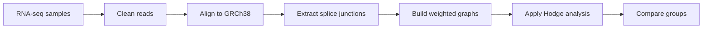

# Splice Girl

**Using graphs and Hodge theory to study RNA splicing in endometriosis**

Splice Girl is a research software project that turns RNA splice-junction data
into graphs. Those graphs let us ask whether RNA connections are organized
differently in endometriosis and control endometrial tissue.

> **Current status:** the software prototype, graph construction, Hodge
> decomposition, sample comparison, and mathematical checks are working. The
> eight public RNA-seq samples are now entering the real-data processing stage,
> so no final biological result is being claimed yet.

## The project in some short stuff?

1. RNA sequencing shows which parts of a gene were connected in each sample.
2. Splice Girl represents those connections as a graph.
3. Hodge theory separates the graph signal into node-explainable flow and
   alternative-path or cycle-space flow.
4. We compare the resulting measurements between four control and four
   endometriosis samples.

The goal is to move from millions of sequencing reads to a small set of
transparent, mathematically checked measurements that can support biological
interpretation.

## Explore the project

| If you are interested in... | Read this section |
|---|---|
| The biological question | [Why study RNA splicing?](#why-study-rna-splicing) |
| The graph idea | [From RNA connections to a graph](#from-rna-connections-to-a-graph) |
| The mathematics | [Why Hodge theory?](#why-hodge-theory) |
| The software | [What Splice Girl does](#what-splice-girl-does) |
| Our progress | [What we have built](#what-we-have-built) |
| The public data | [The eight-sample study](#the-eight-sample-study) |
| A live demonstration | [Try Splice Girl](#try-splice-girl) |
| An unfamiliar word | [Beginner dictionary](#beginner-dictionary) |
| Scientific cautions | [How to interpret the results](#how-to-interpret-the-results) |

## The research question

**Do endometriosis samples organize their RNA splice connections differently
from control samples?**

Traditional RNA-seq summaries can tell us how much of a gene was detected or
how many reads support one junction. Our project asks an additional question:
how do all of a gene's observed junctions fit together as a connected
structure?

The first analysis uses tissue-matched public RNA-seq samples from
proliferative endometrium. Every sample will pass through the same cleaning,
alignment, junction-extraction, graph, and mathematical-analysis steps.

## Why study RNA splicing?

A gene is not always used as one uninterrupted block. Cells first copy a gene
into an early RNA molecule containing sections called **exons** and **introns**.
During splicing, introns are usually removed and selected exons are joined.

Different joining choices can produce different finished RNA molecules from
the same gene. This is called **alternative splicing**. Changes in these
choices may affect which RNA and protein products a cell can make.

RNA sequencing gives us short reads that support particular exon-to-exon
connections. Those connections are called **splice junctions**. Splice Girl
uses the junctions as evidence; it does not guess connections that were not
observed.

## From RNA connections to a graph

For one gene in one sample:

- an exon or splice site becomes a **node**;
- an observed splice junction becomes a directed **edge**;
- the number of reads supporting the junction becomes its **weight**.

A simple exon path might look like this:

```text
E1 ─────→ E2 ─────→ E3
```

An exon-skipping event adds another possible route:

```text
E1 ─────→ E2 ─────→ E3
 └────────────────→ E3
```

The second graph contains more than a list of counts. It contains two routes
from `E1` to `E3`, which gives it a different topology. Splice Girl is designed
to measure that structure consistently across samples.

## Why Hodge theory?

Hodge theory provides a principled way to separate signal on a graph. Imagine
each weighted junction as an arrow carrying flow.

Splice Girl separates that flow into:

- a **gradient component**, which can be explained by values assigned to the
  nodes; and
- a **cycle-space component**, which remains around alternative paths or loops
  after the best node-based explanation is removed.

The software summarizes the second part with a **cycle fraction**: the share of
the normalized graph signal found in the cycle-space component.

This is useful because two samples can have similar total read support while
distributing that support across different junction patterns. Hodge theory
gives us a reproducible measurement of that difference.

The full equations and validation identities are available in the
[math specification](docs/math_spec.md). Understanding those equations is not
required to understand the biological goal or run the demonstration.

## Why Rust?

Splice Girl's command-line tool is written in Rust. Rust was chosen because it
is fast, portable, and strict about many programming mistakes before the code
runs. That makes it a strong fit for a reusable analysis tool that may later
run on laptops, lab workstations, or computing clusters.

Rust does not clean or align the raw sequencing reads. Established
bioinformatics programs prepare the junction evidence first. Rust then handles
Splice Girl's input validation, graph construction, mathematical decomposition,
checks, and comparison output.

## What Splice Girl does



In plain language:

1. Public paired-end sequencing reads are retrieved from NCBI.
2. The reads are quality-checked and cleaned.
3. HISAT2 places the reads on the exact GENCODE v50 GRCh38.p14 primary
   assembly, using its matching comprehensive annotation, as recorded in
   [`docs/data_methods.md`](docs/data_methods.md).
4. Junction-spanning reads are mapped to unique annotated exon pairs, with
   edges following biological transcript direction on both strands.
5. A project helper converts those counts into Splice Girl's input format.
6. Splice Girl builds one graph for each sample and gene.
7. The program calculates gradient energy, cycle energy, and cycle fraction.
8. Numerical checks must pass before a result is reported.
9. Eligible control and endometriosis samples can then be compared.

## What we have built

| Completed work | What it means |
|---|---|
| Rust command-line prototype | Splice Girl can run from a terminal or interactive menu. |
| Input validation | Incorrect headers, invalid counts, self-loops, and duplicate edges are rejected clearly. |
| Deterministic graph construction | The same data produces the same node and edge order every time. |
| Hodge decomposition | Junction signal is separated into gradient and cycle-space components. |
| Mathematical acceptance checks | Reconstruction, cycle-space membership, and orthogonality are checked automatically. |
| Synthetic validation examples | Linear, branching, exon-skipping, cyclic, noisy, and edge-case graphs are tested. |
| Sample manifest support | Samples remain separate and are assigned to case or control groups. |
| Gene comparison command | One gene's cycle fractions can be reported across eligible samples. |
| Reproducible result bundles | Metrics, junction components, comparisons, checksums, and run settings can be saved as TSV and JSON files. |
| Preprocessing design | The path from FASTQ reads to Splice Girl junction tables is documented and scripted. |
| Public dataset selection | Four control and four endometriosis RNA-seq samples have been identified. |

The Rust project currently passes **35 automated tests**. Real-data retrieval
is in progress through Galaxy, where the large files can be processed without
filling a personal laptop.

## The eight-sample study

The current dataset is [GEO GSE315857](https://www.ncbi.nlm.nih.gov/geo/query/acc.cgi?acc=GSE315857).
It contains paired-end RNA-seq data from proliferative endometrium.

| Group | Number of samples | SRA runs |
|---|---:|---|
| Control | 4 | `SRR36710390` to `SRR36710387` |
| Endometriosis | 4 | `SRR36710386` to `SRR36710383` |

The complete working manifest is
[`data/metadata/samples.tsv`](data/metadata/samples.tsv). It records the exact
GEO and SRA accessions, internal subject labels, case/control status, matched
tissue, file locations, QC status, and what processing is still pending. The
earlier accession-only table remains in
[`endometriosis-splicing/samples.tsv`](endometriosis-splicing/samples.tsv) for
provenance.

The processing plan is:

```text
8 public SRA runs
        ↓
quality control and cleaning
        ↓
alignment to the same human reference
        ↓
8 splice-junction files
        ↓
one graph per sample and gene
        ↓
Hodge measurements
        ↓
control-versus-endometriosis comparison
```

## How to interpret the results

Splice Girl reports graph measurements, not a diagnosis.

- A larger cycle fraction means more of the normalized junction signal lies
  in the cycle-space component.
- A group difference would mean the measured graph feature differs between the
  sampled control and endometriosis groups.
- A cycle-space signal does **not** automatically prove circular RNA.
- A group difference does **not** prove that endometriosis caused the change.
- The result must still be reviewed for sample quality, tissue comparability,
  batch effects, replicate consistency, effect size, and statistical support.

Negative results are also meaningful. If the groups do not differ, or if the
Hodge measurements do not outperform simpler junction summaries, that should
be reported honestly.

## Try Splice Girl

The demonstration uses tiny synthetic files included in the repository. It
does not download patient data.

### 1. Check Rust

```sh
rustc --version
cargo --version
```

If those commands are missing, install Rust from
[rustup.rs](https://rustup.rs/).

### 2. Open the interactive menu

From the repository folder, run:

```sh
cargo run -- --start
```

Choose **Analyze a junction TSV** and enter:

```text
tests/fixtures/cycle.tsv
```

### 3. Run a direct example

```sh
cargo run -- tests/fixtures/exon_skip.tsv
```

### 4. Draw the splice graph

The visualization uses the synthetic case/control demo data and creates a
self-contained SVG that opens in any web browser:

```sh
cargo run -- visualize case_02 GENE_DEMO examples/demo/junctions.tsv splice-girl-demo.svg
```

The graph keeps the biological direction of each junction, and thicker arrows
have more read support. A small table reports the normalized signal and signed
cycle component for every junction. The figure uses a plain black-and-white
academic style and states the main interpretation limit: cycle-space structure
alone does not prove circular RNA or causation.

### 5. Save results for later analysis

Add `--output` followed by a new folder name:

```sh
cargo run -- gene GENE_DEMO examples/demo/junctions.tsv examples/demo/manifest.tsv \
  --output demo_results
```

The folder contains sample metrics, junction-level components, the comparison
table, and a JSON run manifest. The manifest records the command, software
version, input checksums, and numerical settings so another person can trace
the result back to its inputs. Splice Girl will not overwrite an existing
results folder.

### 6. Run the automated checks

```sh
cargo test
```

The linear and branching examples should have a cycle fraction near `0`. The
equal-weight directed cycle should have a cycle fraction near `1`. The
exon-skipping example should have a smaller nonzero cycle fraction because it
contains an alternative path.

## What the output means

A result includes:

| Output | Meaning |
|---|---|
| `nodes` | Number of exons or splice sites in the graph |
| `edges` | Number of observed splice junctions |
| `signal_energy` | Total squared size of the normalized junction signal |
| `gradient_energy` | Signal explained by the node-based component |
| `cycle_energy` | Signal remaining in the cycle-space component |
| `cycle_fraction` | Cycle energy divided by total signal energy |
| `checks: PASS` | The required mathematical identities passed within tolerance |

The program also prints each edge's original normalized signal, gradient
component, and cycle component so the calculation can be inspected rather
than treated as a black box.

## Beginner dictionary

| Term | Plain-language meaning |
|---|---|
| **RNA** | A molecule cells use to carry and use genetic instructions. |
| **RNA-seq** | A sequencing experiment that gives evidence about RNA molecules in a sample. |
| **Gene** | A region of DNA used to make a functional RNA or protein product. |
| **Exon** | A section of a gene that can remain in the finished RNA. |
| **Intron** | A section usually removed before the RNA is finished. |
| **Splicing** | Removing introns and joining selected exons. |
| **Alternative splicing** | Producing different RNA forms by joining exons in different ways. |
| **Splice junction** | The observed connection between two exons. |
| **Read** | One short sequence produced by a sequencing machine. |
| **Read support** | The number of reads supporting a junction. |
| **FASTQ** | A file containing sequencing reads and quality scores. |
| **Paired-end** | Sequencing both ends of each RNA-derived fragment. |
| **Reference genome** | A standard genome sequence used as a map for alignment. |
| **GRCh38 / hg38** | A commonly used human reference-genome version. |
| **Alignment** | Matching a sequencing read to a location in the reference genome. |
| **Quality control** | Checks for low-quality reads and technical problems. |
| **Graph** | A collection of points and connections. |
| **Node / vertex** | A graph point; here it represents an exon or splice site. |
| **Edge** | A graph connection; here it represents a splice junction. |
| **Directed edge** | A connection with a start and end, such as `E1 -> E2`. |
| **Edge weight** | A value attached to an edge; here it comes from read support. |
| **Gradient component** | The part of edge signal explained by node values. |
| **Cycle-space component** | Remaining signal associated with alternative paths or graph loops. |
| **Cycle fraction** | The share of normalized signal energy in the cycle-space component. |
| **Manifest** | A table connecting each sample ID to its condition and metadata. |
| **CLI** | A program operated by typing commands in a terminal. |
| **Prototype** | An early working version used to test and validate the main idea. |

## Important limitations

Splice Girl is a research prototype, not a clinical diagnostic tool. The
current command performs per-sample graph analysis and a basic gene-level
sample comparison. Final group statistics, multiple-testing correction,
gene ranking, baseline comparisons, and biological interpretation remain
future stages of the study.

Real RNA-seq results will depend on consistent preprocessing, the selected
reference and annotation, tissue and sample comparability, sequencing quality,
and the number of biological replicates. These limits will be reported with
the final analysis.

## Technical documentation

Audience members who want more detail can continue with:

- [Math specification](docs/math_spec.md) — equations and numerical checks
- [Data contract](docs/data_contract.md) — accepted TSV formats and the frozen Rust CLI interface
- [Preprocessing guide](preprocessing/README.md) — FASTQ-to-junction workflow
- [Execution roadmap](ROADMAP.md) — detailed implementation plan
- [Beginner task guide](delegations_and_tasks/tasks.md) — team work breakdown
- [Contribution logs](logs/README.md) — dated development record
- [Original README](oldREADME.md) — archived earlier project overview

## Repository map

| Location | Purpose |
|---|---|
| `src/` | Rust source code |
| `tests/` | Automated tests and synthetic examples |
| `endometriosis-splicing/` | Eight-sample study metadata |
| `preprocessing/` | FASTQ and junction-processing scripts |
| `docs/` | Mathematical and data specifications |
| `research/` | Background research and source material |
| `logs/` | Dated contribution records |
| `assets/` | Proposal and terminal artwork |
