# Complete Splice Girl project schema

This is the whole project drawn like a SQL database schema. Each box is one
kind of record produced or used by Splice Girl. The rows inside a box are the
important fields that record carries, and the connecting lines show how one
record depends on another.

**Status date:** October 24, 2026

## How to read it

| Schema notation | Plain meaning |
|---|---|
| `PK` | Primary key: the value that uniquely identifies one record |
| `FK` | Foreign key: a field that points to a record in another box |
| `one` | Exactly one connected record |
| `zero or many` | The connection can produce several records or none yet |
| `status` | `COMPLETE`, `ACTIVE`, `WAITING`, `PLANNED`, or `OPTIONAL` |

```mermaid
erDiagram
    %% LAYER 0: PROJECT SCOPE
    PROJECT {
        string project_id PK
        string name "Splice Girl"
        string version
        string status "ACTIVE"
    }
    RESEARCH_QUESTION {
        string question_id PK
        string project_id FK
        string case_group "endometriosis"
        string control_group "control"
        string tissue "proliferative endometrium"
        string outcome "splice graph structure"
        string status "FROZEN"
    }
    INPUT_CONTRACT {
        string contract_id PK
        string project_id FK
        string version "v0.5"
        string required_columns "five columns"
        string coordinate_rule "1 based closed"
        string sample_rule "never pool samples"
        string status "COMPLETE"
    }
    PROJECT ||--|| RESEARCH_QUESTION : defines
    PROJECT ||--|| INPUT_CONTRACT : freezes

    %% LAYER 1: RESEARCH AND CANDIDATE GENES
    CANDIDATE_GENE {
        string gene_id PK
        string stable_gene_id
        string gene_symbol
        string category "risk environment overlap"
        string review_status
        string status "WAITING"
    }
    GENETIC_EVIDENCE {
        string genetic_evidence_id PK
        string gene_id FK
        string evidence_type
        string source_id
        string inclusion_reason
        string status "WAITING"
    }
    ENVIRONMENTAL_EVIDENCE {
        string environment_evidence_id PK
        string gene_id FK
        string response_context
        string source_id
        string inclusion_reason
        string status "WAITING"
    }
    PROJECT ||--o{ CANDIDATE_GENE : prioritizes
    CANDIDATE_GENE ||--o{ GENETIC_EVIDENCE : supported_by
    CANDIDATE_GENE ||--o{ ENVIRONMENTAL_EVIDENCE : supported_by

    %% LAYER 2: STUDY, SAMPLES, AND RAW READS
    RNA_SEQ_STUDY {
        string study_id PK
        string project_id FK
        string accession "GSE315857"
        string tissue
        string library_layout "paired end"
        int sample_count "8"
        string status "ACTIVE"
    }
    SAMPLE {
        string sample_id PK
        string study_id FK
        string srr_accession
        string condition "control or endometriosis"
        string tissue
        string subject_id
        string status "ACTIVE"
    }
    SAMPLE_MANIFEST_ROW {
        string manifest_row_id PK
        string sample_id FK
        string sample_label
        string condition
        string inclusion_status
        string exclusion_reason
        string status "COMPLETE"
    }
    RAW_FASTQ {
        string raw_fastq_id PK
        string sample_id FK
        string read_mate "R1 or R2"
        string file_path
        string checksum
        int read_count
        string status "ACTIVE"
    }
    PROJECT ||--|| RNA_SEQ_STUDY : analyzes
    RNA_SEQ_STUDY ||--|{ SAMPLE : contains
    SAMPLE ||--|| SAMPLE_MANIFEST_ROW : described_by
    SAMPLE ||--|{ RAW_FASTQ : sequenced_as

    %% LAYER 3: EXACT HUMAN REFERENCE
    REFERENCE_BUILD {
        string reference_id PK
        string name "GRCh38 p14"
        string provider "GENCODE"
        string release "v50"
        string fasta_path
        string fasta_checksum
        string status "COMPLETE"
    }
    GENE_ANNOTATION {
        string annotation_id PK
        string reference_id FK
        string release "GENCODE v50"
        string gtf_path
        string gtf_checksum
        string sequence_names_checked
        string status "COMPLETE"
    }
    ALIGNER_INDEX {
        string index_id PK
        string reference_id FK
        string aligner "HISAT2"
        string aligner_version
        string splice_hint_source
        string status "ACTIVE"
    }
    REFERENCE_BUILD ||--|| GENE_ANNOTATION : matched_with
    REFERENCE_BUILD ||--|| ALIGNER_INDEX : builds
    GENE_ANNOTATION ||--|| ALIGNER_INDEX : supplies_splice_hints

    %% LAYER 4: PREPROCESSING
    PREPROCESSING_RUN {
        string preprocessing_id PK
        string sample_id FK
        string reference_id FK
        string cleaning_tool "Cleaver X fastp"
        string aligner "HISAT2"
        string command
        string status "ACTIVE"
    }
    QC_REPORT {
        string qc_report_id PK
        string preprocessing_id FK
        string stage "raw clean alignment"
        string tool "FastQC MultiQC"
        int input_reads
        int retained_reads
        string qc_status
        string status "ACTIVE"
    }
    CLEAN_FASTQ {
        string clean_fastq_id PK
        string preprocessing_id FK
        string read_mate "R1 or R2"
        string file_path
        int retained_reads
        string phix_filter "optional"
        string status "ACTIVE"
    }
    ALIGNMENT_FILE {
        string alignment_id PK
        string preprocessing_id FK
        string index_id FK
        string bam_path
        float mapped_fraction
        float concordant_fraction
        string status "WAITING"
    }
    OBSERVED_JUNCTION {
        string observed_junction_id PK
        string alignment_id FK
        string chromosome
        int intron_start
        int intron_end
        string strand
        int supporting_reads
        string status "WAITING"
    }
    JUNCTION_FILTER_EVENT {
        string filter_event_id PK
        string observed_junction_id FK
        string decision "keep or exclude"
        string reason
        int threshold
        string status "WAITING"
    }
    SAMPLE ||--o{ PREPROCESSING_RUN : processed_by
    REFERENCE_BUILD ||--o{ PREPROCESSING_RUN : anchors
    GENE_ANNOTATION ||--o{ PREPROCESSING_RUN : annotates
    RAW_FASTQ ||--o{ PREPROCESSING_RUN : enters
    PREPROCESSING_RUN ||--o{ QC_REPORT : records
    PREPROCESSING_RUN ||--|{ CLEAN_FASTQ : creates
    PREPROCESSING_RUN ||--o| ALIGNMENT_FILE : creates
    ALIGNER_INDEX ||--o{ ALIGNMENT_FILE : used_by
    ALIGNMENT_FILE ||--o{ OBSERVED_JUNCTION : yields
    GENE_ANNOTATION ||--o{ OBSERVED_JUNCTION : maps
    OBSERVED_JUNCTION ||--|| JUNCTION_FILTER_EVENT : receives

    %% LAYER 5: STANDARD INPUT AND SAFE CLI
    JUNCTION_INPUT_ROW {
        string input_row_id PK
        string sample_id FK
        string gene_id FK
        string from_node
        string to_node
        int count
        string validation_status
        string status "WAITING"
    }
    SOFTWARE_BUILD {
        string build_id PK
        string project_id FK
        string language "Rust"
        string executable "splice-girl"
        string version
        int automated_tests "56"
        string status "COMPLETE"
    }
    ANALYSIS_RUN {
        string run_id PK
        string build_id FK
        string contract_id FK
        string command
        string input_checksum
        string started_at
        string status "COMPLETE"
    }
    VALIDATION_ERROR {
        string error_id PK
        string run_id FK
        string file_name
        int line_number
        string column_name
        string bad_value
        string suggested_fix
        string status "COMPLETE"
    }
    VALIDATION_AUDIT {
        string audit_id PK
        string run_id FK
        int junction_rows
        int sample_count
        int gene_count
        int math_checks_failed
        string sample_mismatches
        string status "COMPLETE"
    }
    JUNCTION_FILTER_EVENT ||--o| JUNCTION_INPUT_ROW : converts_to
    SAMPLE ||--o{ JUNCTION_INPUT_ROW : keeps_separate
    CANDIDATE_GENE ||--o{ JUNCTION_INPUT_ROW : identifies
    PROJECT ||--|| SOFTWARE_BUILD : implements
    SOFTWARE_BUILD ||--o{ ANALYSIS_RUN : executes
    INPUT_CONTRACT ||--o{ ANALYSIS_RUN : validates
    ANALYSIS_RUN ||--o{ VALIDATION_ERROR : may_stop_with
    ANALYSIS_RUN ||--o| VALIDATION_AUDIT : audits

    %% LAYER 6: GRAPH CONSTRUCTION
    GENE_GRAPH {
        string graph_id PK
        string run_id FK
        string sample_id FK
        string gene_id FK
        int node_count
        int edge_count
        float total_support
        string status "COMPLETE"
    }
    EXON_NODE {
        string node_id PK
        string graph_id FK
        string chromosome
        int exon_start
        int exon_end
        string strand
        int deterministic_order
        string status "COMPLETE"
    }
    JUNCTION_EDGE {
        string edge_id PK
        string graph_id FK
        string input_row_id FK
        string source_node_id FK
        string target_node_id FK
        int read_support
        float normalized_signal
        string status "COMPLETE"
    }
    ANALYSIS_RUN ||--o{ GENE_GRAPH : groups_by_sample_gene
    SAMPLE ||--o{ GENE_GRAPH : owns
    CANDIDATE_GENE ||--o{ GENE_GRAPH : represents
    GENE_GRAPH ||--|{ EXON_NODE : contains
    GENE_GRAPH ||--|{ JUNCTION_EDGE : contains
    JUNCTION_INPUT_ROW ||--o| JUNCTION_EDGE : becomes
    EXON_NODE ||--o{ JUNCTION_EDGE : connects

    %% LAYER 7: HODGE MATHEMATICS
    HODGE_RESULT {
        string hodge_result_id PK
        string graph_id FK
        float observed_energy
        float gradient_energy
        float cycle_energy
        float cycle_fraction
        float tolerance "1e-9"
        string status "COMPLETE"
    }
    EDGE_COMPONENT {
        string edge_component_id PK
        string hodge_result_id FK
        string edge_id FK
        float observed_signal
        float gradient_component
        float cycle_component
        string status "COMPLETE"
    }
    MATH_CHECK {
        string math_check_id PK
        string hodge_result_id FK
        string check_type "reconstruction kernel orthogonality"
        float residual
        float tolerance
        boolean passed
        string status "COMPLETE"
    }
    GENE_GRAPH ||--|| HODGE_RESULT : decomposes_into
    HODGE_RESULT ||--|{ EDGE_COMPONENT : explains_each_edge
    JUNCTION_EDGE ||--|| EDGE_COMPONENT : receives_components
    HODGE_RESULT ||--|{ MATH_CHECK : must_pass

    %% LAYER 8: SYNTHETIC VALIDATION
    TEST_CASE {
        string test_id PK
        string build_id FK
        string test_name
        string graph_shape "chain branch triangle cycle noise"
        float expected_cycle_fraction
        float observed_cycle_fraction
        boolean passed
        string status "COMPLETE"
    }
    ACCEPTANCE_RUN {
        string acceptance_id PK
        string build_id FK
        int tests_passed "56"
        int tests_failed "0"
        boolean release_gate
        string status "COMPLETE"
    }
    SOFTWARE_BUILD ||--|{ TEST_CASE : checked_by
    SOFTWARE_BUILD ||--o{ ACCEPTANCE_RUN : qualifies_through
    ACCEPTANCE_RUN ||--|{ TEST_CASE : summarizes

    %% LAYER 9: SAMPLE PRESERVING COMPARISON
    SAMPLE_GENE_METRIC {
        string metric_id PK
        string hodge_result_id FK
        string sample_id FK
        string gene_id FK
        string condition
        float cycle_fraction
        boolean math_checks_passed
        string status "COMPLETE"
    }
    GENE_COMPARISON {
        string comparison_id PK
        string gene_id FK
        int eligible_cases
        int eligible_controls
        float case_mean
        float control_mean
        float case_median
        float control_median
        float mean_difference
        string inference_status "descriptive only"
        string status "COMPLETE"
    }
    COMPARISON_MEMBER {
        string member_id PK
        string comparison_id FK
        string metric_id FK
        boolean included
        string exclusion_reason
        string status "COMPLETE"
    }
    HODGE_RESULT ||--|| SAMPLE_GENE_METRIC : summarizes
    SAMPLE ||--o{ SAMPLE_GENE_METRIC : contributes
    CANDIDATE_GENE ||--o{ SAMPLE_GENE_METRIC : measured_for
    CANDIDATE_GENE ||--o{ GENE_COMPARISON : compared_as
    GENE_COMPARISON ||--|{ COMPARISON_MEMBER : preserves_samples
    SAMPLE_GENE_METRIC ||--o{ COMPARISON_MEMBER : joins

    %% LAYER 10: STATISTICS AND BASELINES
    STATISTICAL_RESULT {
        string statistic_id PK
        string comparison_id FK
        float effect_size
        float p_value
        float q_value
        int permutation_seed
        int permutation_count
        string inference_status
        string status "WAITING"
    }
    BASELINE_RESULT {
        string baseline_id PK
        string comparison_id FK
        string method "junction usage or cycle rank"
        float effect_size
        string result
        string status "WAITING"
    }
    SENSITIVITY_RESULT {
        string sensitivity_id PK
        string statistic_id FK
        string changed_setting
        string approved_value
        float resulting_effect
        string status "PLANNED"
    }
    GENE_COMPARISON ||--o| STATISTICAL_RESULT : tested_by
    GENE_COMPARISON ||--o{ BASELINE_RESULT : compared_against
    STATISTICAL_RESULT ||--o{ SENSITIVITY_RESULT : challenged_by

    %% LAYER 11: INTERPRETATION AND SCIENTIFIC LIMITS
    GENE_INTERPRETATION {
        string interpretation_id PK
        string gene_id FK
        string statistic_id FK
        string evidence_category
        string junction_explanation
        string conclusion
        string review_status
        string status "WAITING"
    }
    SCIENTIFIC_LIMITATION {
        string limitation_id PK
        string limitation_type
        string statement
        string required_wording
        string status "FROZEN"
    }
    CANDIDATE_GENE ||--o| GENE_INTERPRETATION : receives
    STATISTICAL_RESULT ||--o| GENE_INTERPRETATION : supports
    GENETIC_EVIDENCE ||--o{ GENE_INTERPRETATION : informs
    ENVIRONMENTAL_EVIDENCE ||--o{ GENE_INTERPRETATION : informs
    GENE_INTERPRETATION }o--o{ SCIENTIFIC_LIMITATION : constrained_by

    %% LAYER 12: FILES, FIGURES, REPORTS, AND RELEASES
    OUTPUT_BUNDLE {
        string output_id PK
        string run_id FK
        string output_directory
        string metrics_tsv
        string components_tsv
        string comparisons_tsv
        string status "COMPLETE"
    }
    RUN_MANIFEST {
        string run_manifest_id PK
        string output_id FK
        string command
        string software_version
        string input_checksums
        string settings
        string exclusions
        string status "COMPLETE"
    }
    GRAPH_FIGURE {
        string figure_id PK
        string hodge_result_id FK
        string output_id FK
        string format "SVG"
        string panels "observed gradient cycle"
        string generated_from_data
        string status "COMPLETE"
    }
    FINAL_REPORT {
        string report_id PK
        string project_id FK
        string methods_version
        string result_tables
        string limitation_section
        string review_status
        string status "WAITING"
    }
    SOFTWARE_RELEASE {
        string release_id PK
        string build_id FK
        string acceptance_id FK
        string version
        string source_archive
        string example_data
        string status "WAITING"
    }
    ANALYSIS_RUN ||--o{ OUTPUT_BUNDLE : writes
    OUTPUT_BUNDLE ||--|| RUN_MANIFEST : documents
    OUTPUT_BUNDLE ||--o{ GRAPH_FIGURE : includes
    HODGE_RESULT ||--o| GRAPH_FIGURE : visualized_as
    PROJECT ||--o| FINAL_REPORT : concludes_with
    GENE_INTERPRETATION ||--o{ FINAL_REPORT : summarized_in
    STATISTICAL_RESULT ||--o{ FINAL_REPORT : reported_in
    SOFTWARE_BUILD ||--o{ SOFTWARE_RELEASE : packaged_as
    ACCEPTANCE_RUN ||--o| SOFTWARE_RELEASE : unlocks
    OUTPUT_BUNDLE ||--o{ SOFTWARE_RELEASE : demonstrates
```

## The shortest path through the schema

Follow these boxes to understand the main analysis:

`RNA_SEQ_STUDY` -> `SAMPLE` -> `RAW_FASTQ` -> `PREPROCESSING_RUN` ->
`OBSERVED_JUNCTION` -> `JUNCTION_INPUT_ROW` -> `GENE_GRAPH` -> `HODGE_RESULT`
-> `SAMPLE_GENE_METRIC` -> `GENE_COMPARISON` -> `STATISTICAL_RESULT` ->
`GENE_INTERPRETATION` -> `FINAL_REPORT`

The side branches are still necessary. The reference boxes make coordinates
reproducible, the evidence boxes explain why genes were selected, the test
boxes verify the software and mathematics, and the limitation boxes prevent
the final report from claiming more than the data supports.

## Detailed documents

- [Project priorities](priorities.md)
- [Full task guide](delegations_and_tasks/tasks.md)
- [Preprocessing methods](docs/data_methods.md)
- [Input and CLI contract](docs/data_contract.md)
- [Hodge mathematics](docs/math_spec.md)
- [Runnable preprocessing notes](preprocessing/README.md)
- [Synthetic demonstration](examples/demo/README.md)
